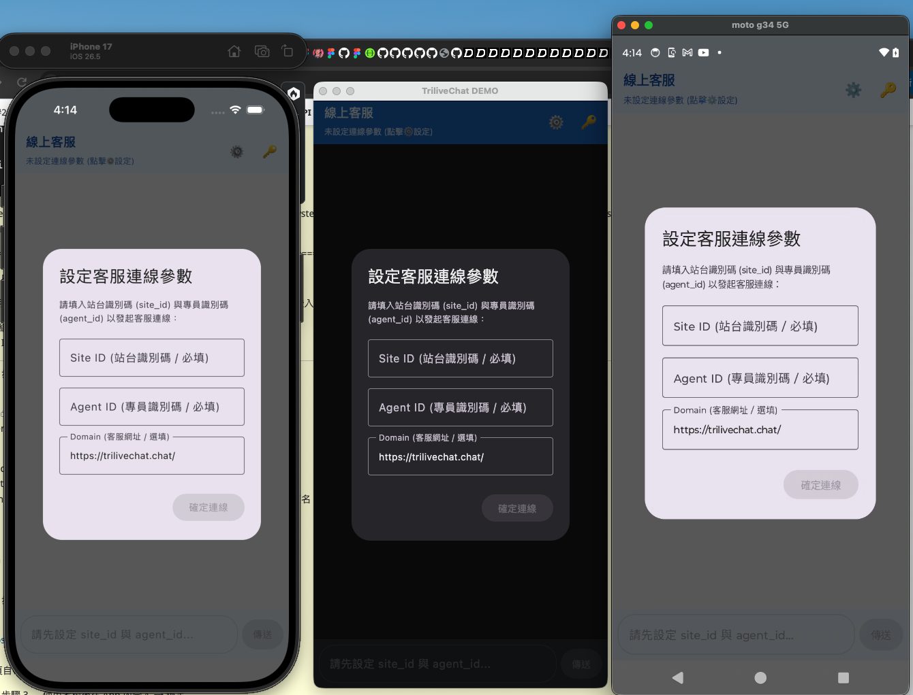

# TriliveChat SDK 展示與應用範例 (AppDemo)

**TriliveChatSDK AppDemo** 是專為 **TriliveChatSDK** 線上客服系統設計的宿主展示應用程式（Host Application Level），展示與驗證如何在 Kotlin Multiplatform 跨平台（Android、iOS、Desktop、Web）應用程式中完整整合並調用線上客服功能。

---

## 📸 SDK 畫面展示



---

## 🎯 專案用途與定位

本示範模組模擬真實宿主 App (Host App) 的整合情境，提供 SDK 開發者與整合團隊作為示範參考：
- **跨平台一致 UI/UX**：透過 Compose Multiplatform (Material 3) 在 Android、iOS、Desktop (JVM) 與 Web (JS/WasmJS) 實現完全一致的即時客服對話體驗。
- **預設無連線 & 彈性設定**：進入客服畫面預設不自動建立連線，可於 UI 上開啟 ⚙️ 設定對話框動態輸入 `site_id` 與 `agent_id`（及自訂 Domain）後發起連線。
- **匿名對話與身分升級**：支援訪客匿名建立 Session 對話，並可隨時點擊 🔑 綁定玩家 Auth JWT Token 進行即時身分驗證升級。
- **多媒體與安全防護**：支援文字發送、圖片選取傳送、自動歡迎詞（Greeting）、以及 Ktorfit HTTP 網址自動 Failover 重定向。

---

## 🏗️ 專案架構與模組劃分

```
app/ (AppDemo 宿主示範層)
 ├── androidApp/  ---> Android 展示應用程式 (Jetpack Compose + Activity)
 ├── desktopApp/  ---> Desktop (JVM) 展示應用程式 (Compose for Desktop)
 ├── iosApp/      ---> iOS 展示應用程式 (SwiftUI + ComposeUIViewController)
 ├── webApp/      ---> Web 展示應用程式 (Kotlin/JS & WasmJS)
 └── docs/        ---> 說明文件與展示截圖資源
      └── sdk.png ---> SDK 展示介面截圖
```

---

## 🔄 核心業務流程

```
[宿主 App (Host App)]
        │
        ├─► 1. 傳入 siteId & agentId (& 可選之玩家 Token / Domain)
        │
        ▼
[TriliveChatSDK (App / LiveChatScreen)]
        │
        ├─► 2. 檢查連線參數 (siteId & agentId)
        │     ├─ 若缺失 ──► 跳出 ⚙️ 設定對話框供使用者填寫
        │     └─ 若齊備 ──► 初始化 Session (SessionCoordinator)
        │
        ├─► 3. Session 建立與升級
        │     ├─ 若有 Token ──► 以已驗證玩家身分建立對話
        │     └─ 若無 Token ──► 以匿名訪客身分建立對話
        │
        ├─► 4. 取得站台/專員資訊 & 觸發 Greeting 歡迎詞
        │
        ├─► 5. 訊息互動 (文字傳送 / 圖片上傳 / 自動重試)
        │
        └─► 6. 動態身分升級 (匿名使用者點擊 🔑 綁定玩家 Token)
```

---

## 🚀 建置與運行指南

### 1. Android 應用程式 (`:androidApp`)
在 Android Studio 中選擇 `:androidApp` 執行，或透過 Command Line 構建：
```bash
./gradlew :androidApp:assembleDebug
```

### 2. Desktop 桌面應用程式 (`:desktopApp`)
執行 Compose for Desktop 桌面端應用程式：
```bash
./gradlew :desktopApp:run
```

### 3. iOS 應用程式 (`iosApp`)
於 Xcode 或命令列中開啟並運行：
```bash
# 開啟 Xcode 專案
open app/iosApp/iosApp.xcodeproj

# 或透過 xcodebuild 編譯並執行於 Simulator
xcodebuild -project app/iosApp/iosApp.xcodeproj -scheme iosApp -sdk iphonesimulator -destination 'platform=iOS Simulator,name=iPhone 16' build
```

### 4. Web 應用程式 (`:webApp`)
執行 Kotlin/JS 或 WasmJS Web 應用程式：
```bash
# 運行 JS 瀏覽器開發伺服器
./gradlew :webApp:jsBrowserDevelopmentRun

# 運行 WasmJS 瀏覽器開發伺服器
./gradlew :webApp:wasmJsBrowserDevelopmentRun
```

---

## 🛠️ 技術棧說明

- **Language**: Kotlin 2.x & Swift 5
- **Cross-Platform UI**: Compose Multiplatform (Material 3)
- **Dependency Injection**: Koin 4.x
- **Networking**: Ktorfit + Ktor Client (CIO / Darwin / JS)
- **Serialization**: kotlinx.serialization
